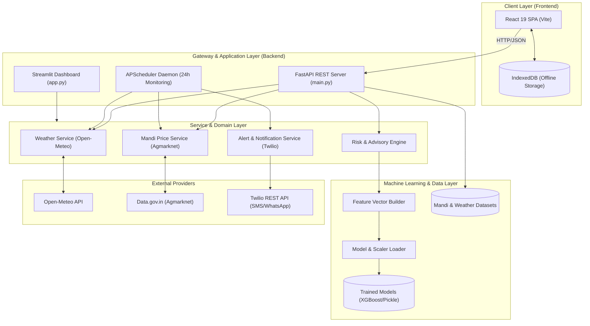

# System Architecture & Technical Design

## 1. Executive Summary

**KrishiShield AI** is an intelligent agricultural decision-support and risk mitigation platform. It combines real-time meteorological forecasting, historical agricultural mandi prices, and machine learning regression models to predict market price fluctuations 7 days into the future and provide actionable agronomic advisories to farmers and agricultural stakeholders.

---

## 2. High-Level Architecture Diagram



---

## 3. Core Modules & Responsibilities

### 3.1 Backend Presentation & API Layer (`backend/src/api/`)
- **`routes.py`**:
  - `GET /alerts`: Serves historical risk alerts triggered across crops.
  - `GET /markets/{crop}`: Returns unique, sorted mandis corresponding to the chosen crop.
  - `POST /analyze`: Coordinates weather extraction, mandi pricing, feature vector formulation, model inference, and risk categorization.
- **`schemas.py`**: Strictly enforces incoming request and outgoing response payloads via Pydantic models.

### 3.2 Machine Learning Subsystem (`backend/src/ml/`)
- **`model_loader.py`**:
  - Encapsulates dual-format model loading:
    - **Onion**: Loads native XGBoost JSON booster (`onion_xgboost_model_diff.json`) operating on a differential pricing approach ($P_{\text{projected}} = P_{\text{baseline}} + \Delta_{\text{pred}}$).
    - **Wheat / Potato / Tomato / Rice**: Loads serialized Scikit-Learn/XGBoost pickle pipelines with corresponding `StandardScaler` instances.
- **`feature_engineering.py`**:
  - Dynamically inspects the target model's booster feature names.
  - Synthesizes fuel prices (Petrol, Diesel), historical lags ($Lag_1$ to $Lag_4$), rolling mean/standard deviation ($4\text{w}$), seasonal interactions ($\text{Rain} \times \text{Month}$, $\text{Humidity} \times \text{Temp}$), and current weather parameters.

### 3.3 Domain Services (`backend/src/services/`)
- **`weather_service.py`**: Communicates with the Open-Meteo forecast endpoint for daily and hourly meteorological indices (temperature, relative humidity, surface pressure, soil moisture, precipitation). Implements seamless offline caching in `data/storage/offline_weather_cache.csv`.
- **`agmarknet_service.py`**: Queries the Indian Government Open Data Platform (`data.gov.in`) for mandi prices across Maharashtra, generating modal prices, weekly lags, and rolling statistics.
- **`risk_service.py`**:
  - Maps predicted percentage price variation ($\Delta\%$) into calibrated risk scores ($0-100\%$) and risk tiers (`LOW RISK`, `MODERATE RISK`, `HIGH RISK`).
  - Synthesizes domain-specific agronomic advisories (irrigation, planting delays, pest inspection, storage logistics).
  - Interpolates 30-day historical trend curves with the 7-day projected horizon.
- **`alert_service.py`**: Manages persistent JSON storage of alerts in `data/storage/alert_history.json`.
- **`notification_service.py`**: Dispatches automated SMS and WhatsApp warnings to farmers via Twilio when anomalous price jumps exceeding $10\%$ are detected.

### 3.4 Automated Monitoring (`backend/src/scheduler/`)
- **`risk_monitor.py`**: Operates an in-process background cron job via `APScheduler` every 24 hours. Evaluates volatile sentinel crop/market combinations (`Onion in Pune`, `Potato in Nashik`, `Wheat in Mumbai`) and alerts farmers automatically if significant shifts occur.

---

## 4. Frontend Architecture (`frontend/src/`)

### 4.1 UI Component Hierarchy
```
App.jsx (Root State & Layout Orchestrator)
 ├── Sidebar (Crop/Market Selection & Offline Badge)
 ├── NotificationModal (Alert History Popup)
 └── Main Content
      ├── Header (Language Toggle, Connectivity Status, Bell Icon)
      ├── ErrorBanner (Dismissible Error Feedback)
      ├── Metrics Grid
      │    ├── ProjectedPriceCard (Predicted price, target date, % vs norm)
      │    ├── RiskMetricCard (Risk level badge & animated progress bar)
      │    └── WeatherCard (Current temperature & meteorological conditions)
      ├── PriceTrendChart (Recharts line chart: -30d to +7d)
      ├── AdvisoryAlert (Actionable advisory steps)
      └── ForecastTable (7-day forecast impact table)
```

### 4.2 Offline-First Data Strategy (`frontend/src/services/db.js`)
The frontend provides uninterrupted operation even in areas with poor rural internet connectivity via **IndexedDB** (`idb`):
1. **`alerts` Store**: Keeps all historical warnings locally.
2. **`appState` Store**: Remembers last analyzed crop and market across browser refreshes.
3. **`marketLists` Store**: Caches all mandi market names per commodity.
4. **`analysisCache` Store**: Caches full analysis results indexed by `${crop}_${market}`. If the device is offline, previously analyzed markets can be inspected without internet.

---

## 5. Security & Data Protection
- Sensitive credentials (Twilio keys, phone numbers) are isolated in `backend/.env` and excluded from source control.
- Sample configuration is provided in `backend/.env.example`.
- All database and model paths use programmatic dynamic directory resolution to prevent path traversal issues.
